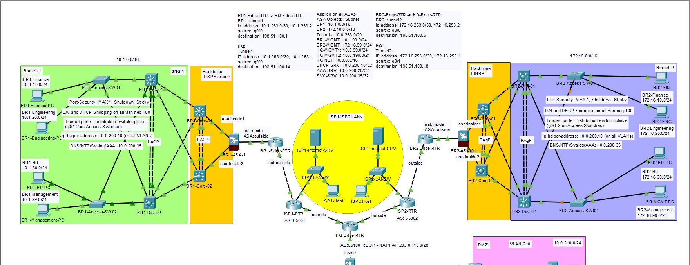
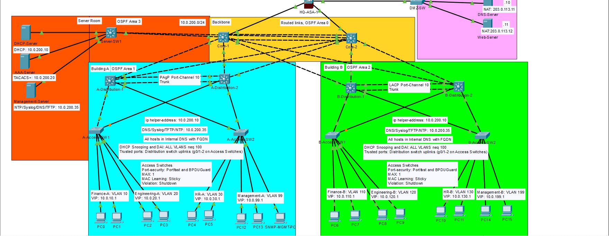

# TNARC Lab 06: SD-WAN and Wi-Fi

## Scenario 
TNARC leadership has requested the deployment of secure wireless at every site. The wireless network must be provided to staff and guests. However, the guest wirelss cannot touch company systems. The current WAN works but does not scale, tunnels are hand-built per branch and each branch only has one ISP. Leadership has asked that the WAN is given ISP redundancy and move the network to an SD-WAN.

## Requirements

#### Part A: Wi-Fi

1. A central wireless LAN controller manages every access point
2. Lightweight APs serve each HQ building and both branches
3. The corporate SSID uses WPA2-Enterprise, authenticating users through RADIUS.
4. The guest SSID reaches the internet only, never a company subnet.
5. Each SSID has its own VLAN and a scope on the central DHCP server.
6. Branch APs join the HQ controller across the VPN.
7. The controller and APs meet the management baseline

#### Part B: SD-WAN design

1. Map the current WAN to its SD-WAN replacement
2. Place the componenets (Manager, Controller, Validator, edge devices)
3. Use both ISPs at every site
4. Keep corporate and guest traffic separated across the WAN
5. Define example policies (application paths, local guest breakout, encryption)
6. A phased migration plan with rollback and a coexistence period.

## Topolgy

## Addressing 

| VLAN | Name | Subnet | Site | Purpose |
|------|------|--------|------|---------|

## Key Decisions
